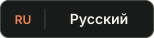

<div align="center">

<a href="README.md"></a>&nbsp;
<a href="README.en.md"></a>

<a href="https://github.com/MakIcon/screen/releases/latest">
  
</a>

<br />

**Your Minecraft. Your builds. Your rules.**

A Minecraft Java Edition launcher for Windows: builds, mods, worlds and settings in one place.

<br />

<a href="https://github.com/MakIcon/screen/releases/latest">
  
</a>

<br />

<sub>Windows x64 · EXE installer · <a href="https://github.com/MakIcon/screen/releases/latest">Latest release</a> · <a href="https://github.com/MakIcon/screen/releases">All versions</a></sub>

<br /><br />

</div>

## What ScreenLauncher offers

- **Separate Minecraft builds.** Vanilla, Fabric, Quilt, Forge and NeoForge with their own mods, Java settings, allocated memory, JVM arguments and environment variables.
- **Modrinth catalog.** Find and install compatible mods, resource packs and shaders, resolve required dependencies, track progress, pause, resume or cancel downloads.
- **Build and world management.** Import and export `.slbuild` and `.mrpack` files, back up worlds, recover deleted builds from the trash, pin and customize build cards.
- **Accounts and character appearance.** Microsoft sign-in, offline profiles, skin and cape management with a 3D preview.
- **Play statistics.** Playtime, recent launches and an activity calendar.
- **English and Russian UI.** Switch the launcher language in Settings.
- **Automatic updates.** Check for new versions on startup or in Settings and install signed updates from the launcher.

## Installation and first launch

1. Click **Install for Windows** above to open the latest published release.
2. Download `ScreenLauncher_…_x64-setup.exe` from **Assets** and run it.
3. Open the launcher, add an account and create a build: choose a Minecraft version and mod loader.
4. Add mods, resource packs and shaders from Modrinth if needed, then press **Play**.

No development tools are needed to install the published launcher. Future versions can be installed through the built-in updater.

## Appearance Studio

Customize the whole launcher and individual interface elements.

- Colors, backgrounds, custom fonts, animated gradients and presets.
- Canvas UI effects: glass, liquid, particles, glitch, VHS, ASCII and 3D objects.
- Custom images, SVG files and GLB/GLTF models for supported effects.
- Pick an element directly in the launcher to style buttons, cards, text and panels.
- Use **Select Settings** to edit labels, sizes, icons and behavior for buttons, text fields, dropdowns, progress bars, sliders, toggles and checkboxes.
- Save per-element settings, undo and redo changes.

Open the editor with **Ctrl+Shift+A**. The **Ctrl+K** command palette helps you find a build, a setting, a launcher action or Modrinth content.

## Plugins and integrations

| Integration               | Features                                                                                                                |
| ------------------------- | ----------------------------------------------------------------------------------------------------------------------- |
| **Mineflayer Bot**        | A separate bot and inventory window, navigation, mining, crafting, farming, item storage, workflows, survival and PvP.  |
| **Proxy**                 | HTTP(S), SOCKS4/4a and SOCKS5/5h; connection profiles, authentication, connection testing and local network exceptions. |
| **Discord Rich Presence** | Show launcher and game activity in Discord.                                                                             |
| **OBS Telemetry**         | Send game data for OBS through a local service and a companion client-side Fabric mod.                                  |
| **BlueMap**               | Configure a BlueMap map and manage its optional server package.                                                         |

Enable and configure integrations separately. Optional packages can be installed from the plugins interface when needed.

Bot documentation: [combat](extensions/mineflayer-bot/COMBAT.md), [survival](extensions/mineflayer-bot/SURVIVAL.md) and [pathfinding](extensions/mineflayer-bot/pathfinding/README.md). Companion mod: [OBS Telemetry](obs-telemetry-mod/README.md).

## Frequently asked questions

<details>
<summary><b>Do I need to install Java manually?</b></summary>

The launcher includes Java runtime management and selection. You can select or download a runtime suitable for your Minecraft version and test it in Settings.

</details>

<details>
<summary><b>Where can I find release notes?</b></summary>

Open the [latest release](https://github.com/MakIcon/screen/releases/latest) for the changelog and download its installer from **Assets**. Previous versions are available in [GitHub Releases](https://github.com/MakIcon/screen/releases).

</details>

<details>
<summary><b>Are Linux and macOS installers available?</b></summary>

The published installer targets **Windows x64**. Source build instructions are below; other platforms require their own tools and compatibility checks.

</details>

<details>
<summary><b>How can I report a bug?</b></summary>

Create an [issue](https://github.com/MakIcon/screen/issues) with the launcher version, steps to reproduce and the error message. Error logs are stored at `%APPDATA%\ScreenLauncher\logs\launcher-errors.jsonl`.

</details>

## Development

<details>
<summary><b>Running and building from source</b></summary>

The frontend uses **React 19 and TypeScript**, built with **Vite 7**. The desktop backend uses **Tauri 2 and Rust**.

Install **Node.js 22**, **pnpm**, **Rust** and the [Tauri platform prerequisites](https://v2.tauri.app/start/prerequisites/). Building the Windows installer also requires Visual Studio Build Tools with the x64 and x86 C++ tools.

```bash
git clone https://github.com/MakIcon/screen.git
cd screen
pnpm install
pnpm tauri dev
```

Build the application and installer:

```bash
pnpm build:app
```

Build a debug executable with the frontend embedded, so it runs without Vite:

```bash
pnpm build:app --debug --no-bundle
```

`build:app` enables `tauri/custom-protocol`, including for debug builds.

| Command                 | Purpose                                                                |
| ----------------------- | ---------------------------------------------------------------------- |
| `pnpm check`            | Check TypeScript and Rust.                                             |
| `pnpm lint`             | Lint maintained frontend, scripts and worker sources.                  |
| `pnpm test:web`         | Check localization and run frontend tests.                             |
| `pnpm test`             | Run Rust tests.                                                        |
| `pnpm test:release`     | Test release publication workflows.                                    |
| `pnpm test:i18n`        | Check dictionaries and localization behavior.                          |
| `pnpm build:pathfinder` | Build the bot navigator used by integration tests.                     |
| `pnpm test:worker`      | Run Mineflayer Bot worker tests.                                       |
| `pnpm test:pathfinder`  | Run full pathfinding simulations; these can take more than 15 minutes. |

Run `pnpm build:pathfinder` before the worker and pathfinder suites. `pnpm test:controls` and `pnpm test:canvas-ui` require a running Vite server and Playwright; set `PLAYWRIGHT_MODULE` to use a separate Playwright installation.

CI checks the frontend on Linux, Rust formatting, Clippy and tests on Linux and Windows, and the worker and pathfinder suites in separate jobs. ESLint excludes local `*.local/` snapshots, build outputs and vendored code.

```text
src/                       React frontend, components and hooks
src-tauri/src/             Tauri commands and Minecraft backend
src-tauri/nsis/            Windows installer and uninstaller
extensions/mineflayer-bot/ Bot worker and pathfinding
obs-telemetry-mod/         Client-side Fabric telemetry helper
public/                    App icon and web assets
scripts/                   Build, packaging and checks
docs/                      Documentation and README assets
```

IPC failures carry `{ code, detail }`: Rust returns `CommandError`, and the UI translates `code` while retaining technical `detail` for diagnostics. See [localization](docs/localization.md) and [Microsoft sign-in with PKCE](docs/microsoft-oauth-pkce.md).

The main app icon is maintained in `public/launcher-icon.svg`; run `pnpm icons` to regenerate platform icons.

</details>

<details>
<summary><b>Publishing releases and automatic updates</b></summary>

Releases are built on Windows. Prepare Markdown release notes and pass a **new version number** through `--version`. For example, for the version after 0.2.3:

```bash
pnpm release --version 0.2.4 --notes-file release-notes.md
pnpm release --skip-build --notes-file release-notes.md --publish
```

The first command updates versions and builds a signed NSIS installer. Files are collected in `dist-release/v<version>/`. The second publishes the installer to GitHub Releases, then updates the updater manifest. Add `--publish` to the first command to do both in one run.

Only the **`.exe`** is attached to the release. The signature and update notes are stored in `latest.json` in a separate [GitHub Gist](https://gist.github.com/MakIcon/7f89bdec5673899ca35511d92c58794a). The launcher uses the permanent URL configured in `plugins.updater.endpoints` in `src-tauri/tauri.conf.json`; keep it free of a revision SHA. GitHub may cache the manifest for a few minutes.

The signing key lives outside the repository at `%USERPROFILE%\.tauri\screenlauncher-updater.key`. Keep a backup: installed launchers accept only updates signed with the matching key. Override its location with `TAURI_SIGNING_PRIVATE_KEY_PATH` or pass its contents through `TAURI_SIGNING_PRIVATE_KEY`.

Publication uses `GH_TOKEN` / `GITHUB_TOKEN`, a `gh` login or the account saved by Git Credential Manager. Authenticate as the Gist owner with release and Gist access; a classic token uses the `repo` and `gist` scopes. GitHub CLI is optional.

Use `--tag` for a custom tag and `--skip-build --publish` to retry without rebuilding. Before publication, ensure the tag points to the commit containing the matching sources; the publication script does not commit or push source changes. The manifest is updated after the installer is available for download.

</details>

<details>
<summary><b>Windows installer</b></summary>

The NSIS installer and uninstaller use the Quiet Start design: welcome, maintenance, folder and shortcut selection, progress and completion pages. Layout lives in `src-tauri/nsis/quiet-start.nsh`, drawing in `skin.cpp`, and the installer template in `installer.nsi`.

Before bundling, `beforeBundleCommand` builds an x86 skin plugin with MSVC and embeds it in the installer. End users need no build tools. Silent flags `/S`, `/UPDATE`, `/NS` and `/R` retain Tauri's behavior; built-in updates run without an installer window.

The template is based on Tauri CLI 2.10.1. When upgrading the CLI, compare changes to Tauri's template, especially update, WebView2 and uninstall handling.

</details>

## Built with

<div align="center">

<a href="https://tauri.app"></a>&nbsp;
<a href="https://www.rust-lang.org"></a>&nbsp;
<a href="https://react.dev"></a>

<sub>React 19 · TypeScript · Vite 7 · Tauri 2 · Rust</sub>

</div>

## Project activity

<div align="center">

<picture>
  <source media="(prefers-color-scheme: dark)" srcset="docs/assets/github-contribution-snake-dark.svg" />
  <source media="(prefers-color-scheme: light)" srcset="docs/assets/github-contribution-snake.svg" />
  
</picture>

<br /><br />

<sub>Made by <a href="https://github.com/MakIcon">MakIcon</a> · <a href="THIRD_PARTY_NOTICES.md">Third-party notices</a> · <a href="https://github.com/MakIcon/screen/issues">Report an issue</a></sub>

<br />

<sub>ScreenLauncher is an independent project and is not affiliated with or endorsed by Mojang Studios or Microsoft.</sub>

</div>
