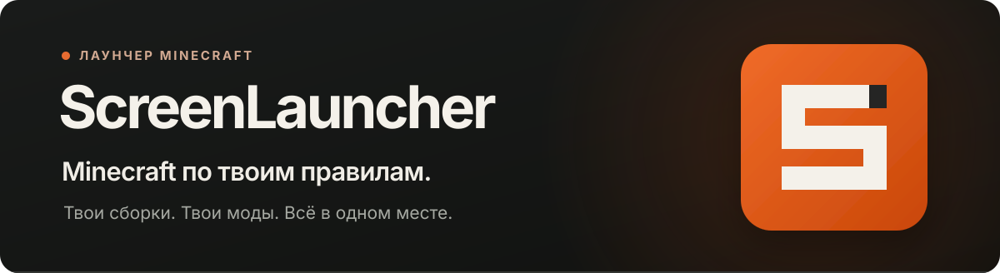

<div align="center">

<a href="README.md"></a>&nbsp;
<a href="README.en.md"></a>

<a href="https://github.com/MakIcon/screen/releases/latest">
  
</a>

<br />

**Твой Minecraft. Твои сборки. Твои правила.**

Лаунчер Minecraft Java Edition для Windows: сборки, моды, миры и настройки в одном месте.

<br />

<a href="https://github.com/MakIcon/screen/releases/latest">
  
</a>

<br />

<sub>Windows x64 · Установщик EXE · <a href="https://github.com/MakIcon/screen/releases/latest">Последний релиз</a> · <a href="https://github.com/MakIcon/screen/releases">Все версии</a></sub>

<br /><br />

</div>

## Что умеет ScreenLauncher

- **Отдельные сборки Minecraft.** Vanilla, Fabric, Quilt, Forge и NeoForge с собственными модами, настройками Java, памятью, аргументами JVM и переменными окружения.
- **Каталог Modrinth.** Поиск и установка совместимых модов, ресурспаков и шейдеров, загрузка обязательных зависимостей, прогресс, пауза, продолжение и отмена загрузок.
- **Управление сборками и мирами.** Импорт и экспорт `.slbuild` и `.mrpack`, резервные копии миров, восстановление удалённых сборок из корзины, закрепление и настройка карточек.
- **Аккаунты и внешний вид персонажа.** Вход Microsoft, офлайн-профили, управление скинами и плащами с 3D-просмотром.
- **Статистика игры.** Время в игре, недавние запуски и календарь активности.
- **Русский и английский интерфейс.** Переключение языка в настройках лаунчера.
- **Автообновление.** Проверка новых версий при запуске и в настройках, установка подписанных обновлений из лаунчера.

## Установка и первый запуск

1. Нажмите **«Установить»** вверху — откроется последний опубликованный релиз.
2. Скачайте установщик `ScreenLauncher_…_x64-setup.exe` из раздела **Assets** и запустите его.
3. Откройте лаунчер, добавьте аккаунт и создайте сборку: выберите версию Minecraft и загрузчик модов.
4. При необходимости установите моды, ресурспаки и шейдеры из Modrinth, затем нажмите **«Играть»**.

Для установки готового лаунчера инструменты разработки не нужны. Следующие версии можно устанавливать через встроенное обновление.

## Appearance Studio

Редактор оформления позволяет настроить весь лаунчер и отдельные элементы интерфейса.

- Цвета, фон, собственные шрифты, анимированные градиенты и готовые пресеты.
- Эффекты Canvas UI: стекло, жидкость, частицы, глитч, VHS, ASCII и 3D-объекты.
- Собственные изображения, SVG и модели GLB/GLTF для поддерживаемых эффектов.
- Выбор элемента прямо в лаунчере: оформление кнопок, карточек, текста и панелей.
- Раздел **Select Settings** для настройки подписей, размеров, иконок и поведения кнопок, полей ввода, списков, прогресс-баров, слайдеров, переключателей и флажков.
- Сохранение настроек элементов, отмена и повтор изменений.

Открыть редактор: **Ctrl+Shift+A**. Палитра **Ctrl+K** помогает найти сборку, раздел настроек, действие лаунчера или контент Modrinth.

## Плагины и интеграции

| Интеграция                | Возможности                                                                                                                    |
| ------------------------- | ------------------------------------------------------------------------------------------------------------------------------ |
| **Mineflayer Bot**        | Отдельное окно бота и инвентаря, навигация, добыча, крафт, фермерство, хранение предметов, сценарии действий, выживание и PvP. |
| **Proxy**                 | HTTP(S), SOCKS4/4a и SOCKS5/5h; профили подключений, авторизация, проверка соединения и исключения для локальной сети.         |
| **Discord Rich Presence** | Отображение активности лаунчера и игры в Discord.                                                                              |
| **OBS Telemetry**         | Передача данных игры для OBS через локальный сервис и вспомогательный клиентский Fabric-мод.                                   |
| **BlueMap**               | Настройка карты BlueMap и управление дополнительным серверным пакетом.                                                         |

Интеграции включаются и настраиваются отдельно. Дополнительные пакеты устанавливаются из интерфейса плагинов, когда они нужны.

Подробнее о боте: [бой](extensions/mineflayer-bot/COMBAT.md), [выживание](extensions/mineflayer-bot/SURVIVAL.md), [поиск пути](extensions/mineflayer-bot/pathfinding/README.md). О вспомогательном моде: [OBS Telemetry](obs-telemetry-mod/README.md).

## Частые вопросы

<details>
<summary><b>Нужно ли устанавливать Java вручную?</b></summary>

В лаунчере есть управление Java и выбор среды выполнения. Для выбранной версии Minecraft можно подобрать или загрузить подходящую Java и проверить её в настройках.

</details>

<details>
<summary><b>Как найти изменения в новой версии?</b></summary>

Откройте [последний релиз](https://github.com/MakIcon/screen/releases/latest): в описании перечислены изменения, а в **Assets** находится установщик. Предыдущие версии доступны в [списке релизов](https://github.com/MakIcon/screen/releases).

</details>

<details>
<summary><b>Есть ли установщики для Linux и macOS?</b></summary>

Готовый установщик распространяется для **Windows x64**. Инструкции по сборке из исходников находятся ниже; для других платформ потребуются соответствующие инструменты и проверка совместимости.

</details>

<details>
<summary><b>Как сообщить об ошибке?</b></summary>

Создайте [issue](https://github.com/MakIcon/screen/issues), укажите версию лаунчера, шаги воспроизведения и текст ошибки. Журнал ошибок находится в `%APPDATA%\ScreenLauncher\logs\launcher-errors.jsonl`.

</details>

## Разработка

<details>
<summary><b>Запуск и сборка из исходников</b></summary>

Интерфейс написан на **React 19 и TypeScript**, сборка использует **Vite 7**, настольная часть — **Tauri 2 и Rust**.

Потребуются **Node.js 22**, **pnpm**, **Rust** и [системные зависимости Tauri](https://v2.tauri.app/start/prerequisites/). Для сборки установщика Windows также нужны Visual Studio Build Tools с компонентами C++ для x64 и x86.

```bash
git clone https://github.com/MakIcon/screen.git
cd screen
pnpm install
pnpm tauri dev
```

Собрать приложение и установщик:

```bash
pnpm build:app
```

Собрать отладочный exe со встроенным интерфейсом, который запускается без Vite:

```bash
pnpm build:app --debug --no-bundle
```

Команда `build:app` включает `tauri/custom-protocol`, в том числе для отладочной сборки.

| Команда                 | Назначение                                                   |
| ----------------------- | ------------------------------------------------------------ |
| `pnpm check`            | Проверка TypeScript и Rust.                                  |
| `pnpm lint`             | Проверка поддерживаемого кода интерфейса, скриптов и worker. |
| `pnpm test:web`         | Проверка локализации и тесты интерфейса.                     |
| `pnpm test`             | Тесты Rust.                                                  |
| `pnpm test:release`     | Проверка сценариев публикации релизов.                       |
| `pnpm test:i18n`        | Проверка словарей и поведения локализации.                   |
| `pnpm build:pathfinder` | Сборка навигатора для бота и интеграционных тестов.          |
| `pnpm test:worker`      | Тесты worker Mineflayer Bot.                                 |
| `pnpm test:pathfinder`  | Полные симуляции поиска пути; могут занимать более 15 минут. |

Перед тестами worker и pathfinder выполните `pnpm build:pathfinder`. Проверки `pnpm test:controls` и `pnpm test:canvas-ui` используют запущенный Vite и Playwright; путь к отдельной установке Playwright можно задать через `PLAYWRIGHT_MODULE`.

CI проверяет интерфейс на Linux, форматирование, Clippy и тесты Rust на Linux и Windows, а worker и pathfinder запускает отдельными заданиями. Локальные снимки `*.local/`, результаты сборки и сторонний код исключены из ESLint.

```text
src/                       Интерфейс React, компоненты и хуки
src-tauri/src/             Команды Tauri и работа с Minecraft
src-tauri/nsis/            Установщик и удаление для Windows
extensions/mineflayer-bot/ Worker бота и поиск пути
obs-telemetry-mod/         Клиентский Fabric-мод телеметрии
public/                    Иконка приложения и веб-ресурсы
scripts/                   Сборка, упаковка и проверки
docs/                      Документация и ресурсы README
```

Ошибки IPC передаются как `{ code, detail }`: Rust возвращает `CommandError`, интерфейс выбирает перевод по `code` и сохраняет технический `detail` для диагностики. Подробности: [локализация](docs/localization.md) и [вход Microsoft с PKCE](docs/microsoft-oauth-pkce.md).

Основная иконка хранится в `public/launcher-icon.svg`; команда `pnpm icons` обновляет иконки для платформ.

</details>

<details>
<summary><b>Публикация релиза и автообновление</b></summary>

Релизы собираются на Windows. Подготовьте описание изменений в Markdown и укажите **новый номер версии** через `--version`. Например, для версии после 0.2.3:

```bash
pnpm release --version 0.2.4 --notes-file release-notes.md
pnpm release --skip-build --notes-file release-notes.md --publish
```

Первая команда обновляет версии и собирает подписанный NSIS-установщик. Файлы сохраняются в `dist-release/v<version>/`. Вторая публикует установщик в GitHub Releases и затем обновляет манифест автообновления. Можно выполнить всё одной командой, добавив `--publish` к первой.

В релиз прикрепляется **только `.exe`**. Подпись и описание обновления находятся в `latest.json`, который хранится в отдельном [GitHub Gist](https://gist.github.com/MakIcon/7f89bdec5673899ca35511d92c58794a). Лаунчер использует постоянный адрес из `plugins.updater.endpoints` в `src-tauri/tauri.conf.json`; в нём не должно быть SHA конкретной ревизии. GitHub может кешировать манифест несколько минут.

Ключ подписи хранится вне репозитория: `%USERPROFILE%\.tauri\screenlauncher-updater.key`. Сохраните его резервную копию: установленный лаунчер принимает только обновления, подписанные соответствующим ключом. Другой путь задаётся через `TAURI_SIGNING_PRIVATE_KEY_PATH`, содержимое ключа — через `TAURI_SIGNING_PRIVATE_KEY`.

Публикация использует `GH_TOKEN` / `GITHUB_TOKEN`, авторизацию `gh` или учётную запись Git Credential Manager. Нужна учётная запись владельца Gist с правами на релизы и Gist; для classic token используются области `repo` и `gist`. GitHub CLI необязателен.

Для нестандартного тега используется `--tag`. Для повторной публикации без пересборки — `--skip-build --publish`. Перед публикацией тег должен указывать на коммит с соответствующими исходниками; скрипт публикации сам не коммитит и не отправляет изменения исходников. Манифест публикуется после установщика, чтобы обновление ссылалось на доступный файл.

</details>

<details>
<summary><b>Установщик Windows</b></summary>

Установщик NSIS и удаление используют оформление Quiet Start: приветствие, обновление существующей установки, выбор папки и ярлыков, прогресс и завершение. Разметка находится в `src-tauri/nsis/quiet-start.nsh`, отрисовка — в `skin.cpp`, шаблон — в `installer.nsi`.

Перед упаковкой `beforeBundleCommand` собирает x86-плагин оформления с помощью MSVC и встраивает его в установщик. Пользователю не требуется устанавливать инструменты сборки. Тихие флаги `/S`, `/UPDATE`, `/NS`, `/R` сохраняют поведение Tauri; встроенное обновление проходит без окна установщика.

Шаблон основан на Tauri CLI 2.10.1. При обновлении CLI сверяйте изменения шаблона Tauri, особенно обработку обновлений, WebView2 и удаления.

</details>

## Технологии

<div align="center">

<a href="https://tauri.app"></a>&nbsp;
<a href="https://www.rust-lang.org"></a>&nbsp;
<a href="https://react.dev"></a>

<sub>React 19 · TypeScript · Vite 7 · Tauri 2 · Rust</sub>

</div>

## Активность проекта

<div align="center">

<picture>
  <source media="(prefers-color-scheme: dark)" srcset="docs/assets/github-contribution-snake-dark.svg" />
  <source media="(prefers-color-scheme: light)" srcset="docs/assets/github-contribution-snake.svg" />
  
</picture>

<br /><br />

<sub>Автор: <a href="https://github.com/MakIcon">MakIcon</a> · <a href="THIRD_PARTY_NOTICES.md">Сторонние компоненты</a> · <a href="https://github.com/MakIcon/screen/issues">Сообщить об ошибке</a></sub>

<br />

<sub>ScreenLauncher — независимый проект, не связанный с Mojang Studios или Microsoft и не одобренный ими.</sub>

</div>
