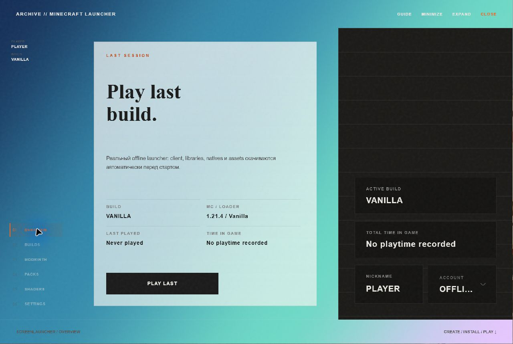
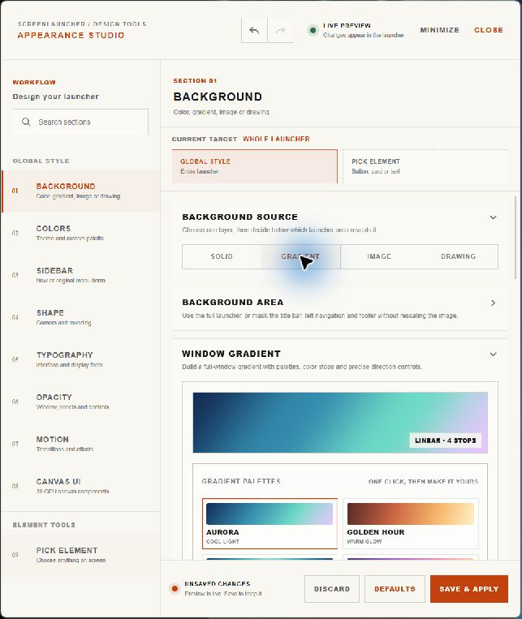
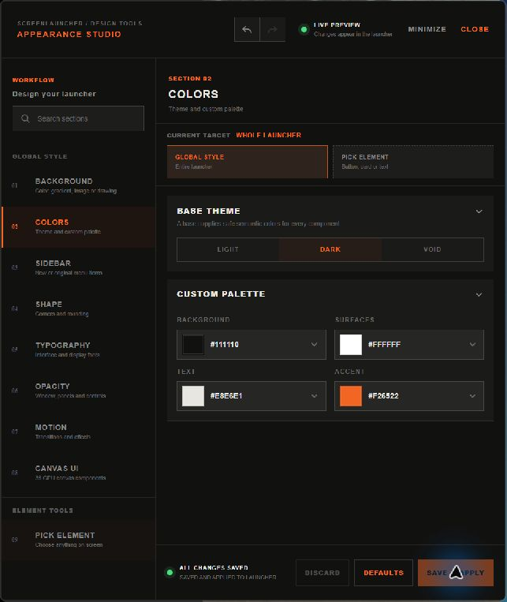
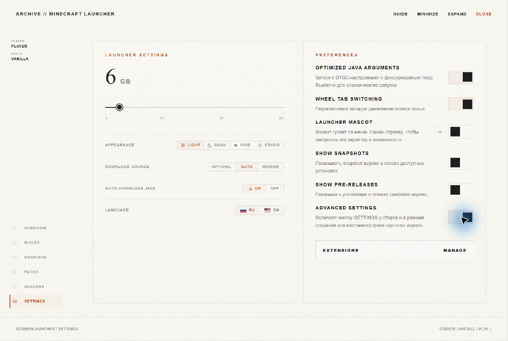
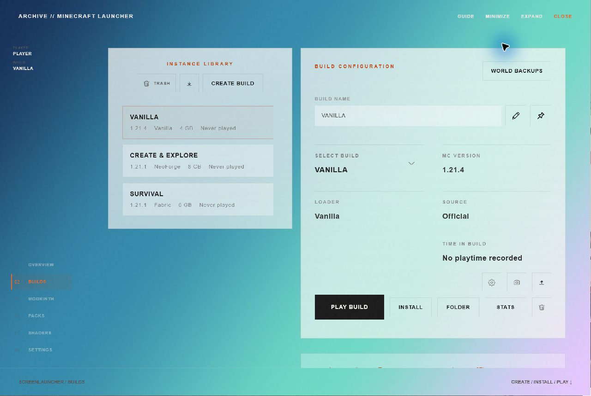
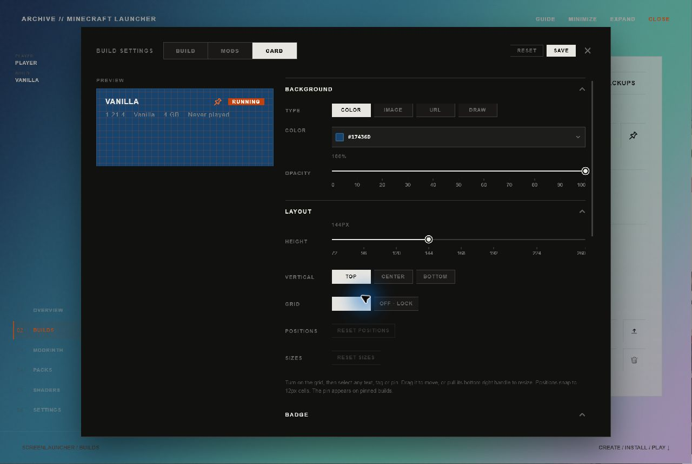
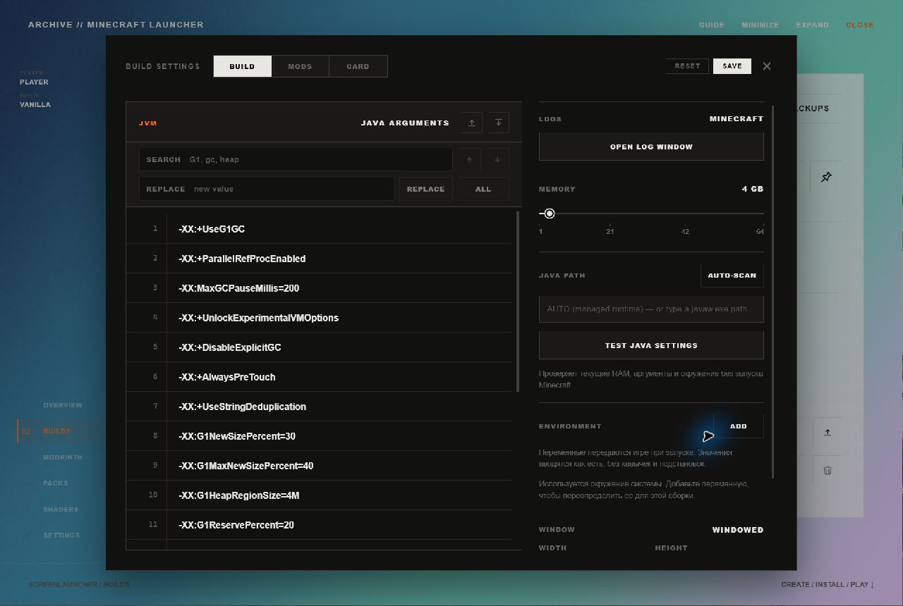
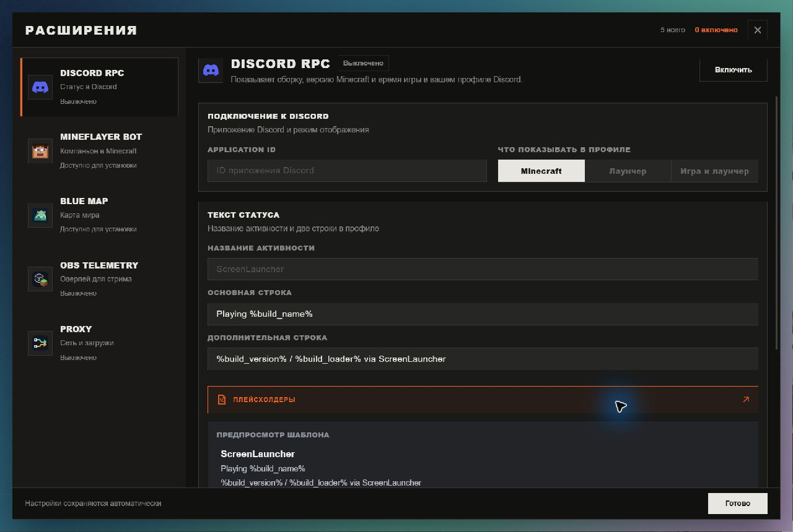

<div align="center">

<a href="https://github.com/MakIcon/screen/releases">
  
</a>

<br />

**Your Minecraft. Your builds. Your rules.**

A customizable desktop Minecraft launcher that brings your builds, mods and settings together.

<br />

<a href="https://github.com/MakIcon/screen/releases/download/apperance/ScreenLauncher_0.1.0_x64-setup.exe">
  
</a>

<br />

<sub>Windows x64 · EXE installer · <a href="https://github.com/MakIcon/screen/releases">All releases</a></sub>

<br /><br />

</div>



<p align="center"><sub>Your launcher, your design. An example made with Appearance Studio.</sub></p>

## Your Minecraft, all in one place

ScreenLauncher makes it easier to organize different Minecraft setups without having to manage their files by hand. Create a build for the way you want to play, install content from Modrinth and launch it from one place.

- **Separate builds, no compromises.** Set up Vanilla, Fabric, Quilt, Forge or NeoForge installations independently. Each build keeps its own configuration.
- **Mods without leaving the launcher.** Discover mods, resource packs and shaders through Modrinth. Required mod dependencies are resolved when installing compatible projects.
- **A look that feels like yours.** Start with Light, Dark or Void, then use Appearance Studio to design the window and customize individual build cards.
- **Extensions when you want more.** Manage Discord RPC, Mineflayer Bot, BlueMap, OBS telemetry and proxy downloads from the launcher.
- **Control over your game.** Choose Java settings, allocated memory and other options for individual builds.
- **Pick up where you left off.** See your recent build and playtime information, then get back into the game.

## Make the launcher yours

**Appearance** gives you quick theme switching. **Appearance Studio** opens a separate design window with a live preview in the launcher, so you can see your changes as you make them.

- **Design the window.** Use a solid color, a gradient, a local image or your own drawing as the background. Choose gradient palettes and fine-tune their color stops and direction.
- **Set the mood.** Adjust the palette, interface and display fonts, corner rounding, and the opacity of the window, panels and controls. Custom fonts are supported too.
- **Choose how it moves.** Customize interface motion, tab transitions, and opening and closing animations.
- **Go element by element.** Pick a button, card or text element in the launcher and give it its own style. Review edited elements, undo or redo changes, then save and apply your design.

<table>
  <tr>
    <td width="50%" align="center"><b>Backgrounds & gradients</b></td>
    <td width="50%" align="center"><b>Themes & custom palettes</b></td>
  </tr>
  <tr>
    <td></td>
    <td></td>
  </tr>
</table>

**Open it:** go to **Settings**, enable **Advanced Settings**, then choose **Appearance → Studio**. You can also open Studio with **Ctrl+Shift+A**.

<details>
<summary><b>Where to find Appearance, Studio and Extensions</b></summary>



</details>

## Give every build its own identity

Keep your survival world, modded setup and vanilla installation in separate builds, each with its own configuration.



The **card editor** lets you customize how each build looks in your library:

- **Backgrounds:** a color, local image, image URL or a drawing, with opacity controls.
- **Layout:** adjust the card height and vertical alignment, then use the grid to move and resize text, tags and the pin.
- **Labels & badges:** customize text, colors and badge visibility. Use plain text or tags, with placeholders for values such as the build version, loader, memory and last played time.

With **Advanced Settings** enabled, open a build's **Build settings → Card** tab to edit its appearance and preview the result before saving.



Build customization also covers the game itself: memory, Java paths, JVM arguments, environment variables, window size and fullscreen settings can be configured per build.

<details>
<summary><b>See the per-build runtime settings</b></summary>



</details>

## Extend your setup

Open **Settings → Extensions → Manage** with **Advanced Settings** enabled to browse integrations and configure them in one place.



| Extension          | What it adds                                                                                                 |
| ------------------ | ------------------------------------------------------------------------------------------------------------ |
| **Discord RPC**    | Show your build, Minecraft version and playtime in your Discord profile, with customizable status templates. |
| **Mineflayer Bot** | A Minecraft companion with movement, gathering, crafting and smelting workflows.                             |
| **BlueMap**        | Create and view an interactive map of a world.                                                               |
| **OBS Telemetry**  | Send player health, armor, food and coordinates to an OBS overlay.                                           |
| **Proxy**          | Route launcher downloads through an HTTP, HTTPS or SOCKS5 proxy.                                             |

Mineflayer Bot and the BlueMap server are optional packages installed from the extensions manager. Each integration has its own settings; enable the ones you want to use.

<sub>Screenshots were captured from the running desktop app with a demonstration profile and custom appearance. Features shown here may differ from the published installer.</sub>

## Download & installation

Getting started doesn't require any development tools.

1. **Download** the Windows installer using the button above.
2. **Install** ScreenLauncher by running the downloaded `.exe` file.
3. **Open the launcher**, create a build, choose your Minecraft version and press Play.

Want to add mods? Open the **Modrinth** section after creating a compatible build.

> [!NOTE]
> The repository is currently **private**, so GitHub downloads require repository access. The latest published release is labeled **v2.0**, although its Windows installer is named `ScreenLauncher_0.1.0_x64-setup.exe`. That published installer may not include every change on the `main` branch.

## More than just a Play button

- **Build import & export** — move or back up build configurations using supported transfer formats.
- **Microsoft and offline account workflows** — manage supported ways to start the game.
- **Flexible runtime settings** — configure Java, JVM arguments and per-build environment variables.
- **Safer downloads** — verify downloaded Minecraft files using available checksums and reuse valid cached files.
- **Optional integrations** — configure the extensions shown above for your own setup.

These extras are available when you need them; you can also keep things simple and just play.

## Frequently asked questions

<details>
<summary><b>Do I need to install Java myself?</b></summary>

ScreenLauncher includes Java runtime selection and management. Depending on your Minecraft version and setup, a compatible runtime may need to be selected or downloaded. A Java settings test can help diagnose problems.

</details>

<details>
<summary><b>Does it support Fabric, Forge and other mod loaders?</b></summary>

Yes. You can create builds for Vanilla, Fabric, Quilt, Forge and NeoForge. The Modrinth browser can help you find content compatible with your build.

</details>

<details>
<summary><b>Where can I download another version?</b></summary>

See [GitHub Releases](https://github.com/MakIcon/screen/releases). The most recent published release provides a Windows x64 EXE installer, and an [older release](https://github.com/MakIcon/screen/releases/tag/first) includes an MSI installer.

</details>

<details>
<summary><b>Is there a macOS or Linux download?</b></summary>

There is no published macOS or Linux installer listed in the repository's current releases. The project is based on Tauri, but that does not mean builds for every platform are already available.

</details>

---

<div align="center">

### Built with

<a href="https://tauri.app"></a>&nbsp;
<a href="https://www.rust-lang.org"></a>&nbsp;
<a href="https://react.dev"></a>

<sub>React 19 · TypeScript · Vite 7 · Tauri 2 · Rust</sub>

</div>

## Activity snake

<div align="center">

<picture>
  <source media="(prefers-color-scheme: dark)" srcset="docs/assets/github-contribution-snake-dark.svg" />
  <source media="(prefers-color-scheme: light)" srcset="docs/assets/github-contribution-snake.svg" />
  
</picture>

</div>

<details>
<summary><b>Development & building from source</b></summary>

ScreenLauncher uses React and TypeScript for its frontend, with Tauri 2 and Rust for its desktop backend.

**Requirements:** Node.js, pnpm, Rust and the [Tauri 2 platform prerequisites](https://v2.tauri.app/start/prerequisites/).

```bash
git clone https://github.com/MakIcon/screen.git
cd screen
pnpm install
pnpm tauri dev
```

To create a native application bundle or installer for your development platform:

```bash
pnpm tauri build
```

Useful checks:

```bash
pnpm check             # TypeScript and Rust
pnpm test              # Rust tests
pnpm test:web          # Frontend tests
pnpm test:pathfinder   # Pathfinder tests
pnpm test:worker       # Mineflayer worker tests
pnpm lint              # Lint frontend code
```

**Project structure**

```text
src/                       React frontend, components and hooks
src-tauri/src/             Tauri commands and Minecraft backend
extensions/mineflayer-bot/ Optional bot worker and pathfinding
obs-telemetry-mod/         Fabric client-side telemetry helper
public/                    App icon and web assets
scripts/                   Build and packaging tools
```

The main application icon is maintained in `public/launcher-icon.svg`. Use `pnpm icons` to regenerate platform icons.

For the bot extension, see the [combat guide](extensions/mineflayer-bot/COMBAT.md), [survival guide](extensions/mineflayer-bot/SURVIVAL.md) and [pathfinding documentation](extensions/mineflayer-bot/pathfinding/README.md).

</details>

<div align="center">

<sub>Made by <a href="https://github.com/MakIcon">MakIcon</a> · <a href="THIRD_PARTY_NOTICES.md">Third-party notices</a> · <a href="https://github.com/MakIcon/screen/issues">Issues</a></sub>

<br />

<sub>ScreenLauncher is an independent project and is not affiliated with or endorsed by Mojang Studios or Microsoft.</sub>

</div>
