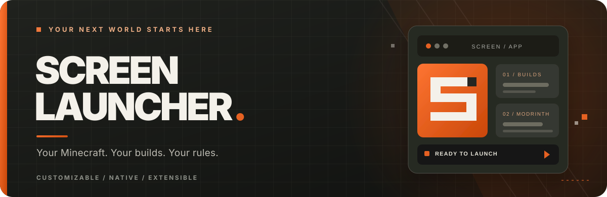

<div align="center">

<a href="https://github.com/MakIcon/screen/releases">
  
</a>

<br /><br />

**Your Minecraft, your way.**

A desktop launcher for the builds you play, the mods you love, and the little details you want to make your own.

<br />

<a href="https://github.com/MakIcon/screen/releases/download/apperance/ScreenLauncher_0.1.0_x64-setup.exe">
  
</a>

<br />

<sub>Windows x64 · <a href="https://github.com/MakIcon/screen/releases/latest">Latest release</a> · <a href="https://github.com/MakIcon/screen/releases">Other versions</a></sub>

<br /><br />

</div>

## Made for the way you play.

No messy folders. No juggling different launchers. Keep everything in one place, and spend less time setting up and more time in Minecraft.

### 01 / Your builds, organized

From a simple vanilla world to a fully modded setup, create separate builds with **Vanilla, Fabric, Quilt, Forge or NeoForge**. Give each one its own settings and switch whenever you like.

### 02 / Mods without the extra steps

Find **mods, resource packs and shaders** using the built-in Modrinth browser. ScreenLauncher handles compatible required mod dependencies as part of installation.

### 03 / Make it yours

Personalize your build cards and launcher appearance. Fine-tune memory and Java settings, and keep track of when you last played.

---

## Ready to play?

1. **Download** the Windows installer above.
2. **Install** ScreenLauncher and open it.
3. **Create a build**, choose your Minecraft version and hit Play.

That's it. Want mods? Head to **Modrinth** inside the launcher and start exploring.

<sub>The currently published Windows installer is <code>ScreenLauncher_0.1.0_x64-setup.exe</code> from the release named v2.0 (August 2026). The release name and application version differ. It may not include every update on the main branch.</sub>

## More to explore

- **Everything in its place** — manage builds, installed content and per-build settings without mixing installations.
- **A personalized launcher** — customize your interface, build cards and game configuration.
- **More when you need it** — optional Discord Rich Presence, Mineflayer Bot and OBS telemetry integrations.

<details>
<summary><b>A few things worth knowing</b></summary>

**Do I need to install Java?** ScreenLauncher offers Java runtime management and configuration. Depending on your setup, you may need to choose a compatible runtime.

**Can I use different mod loaders?** Yes — Vanilla, Fabric, Quilt, Forge and NeoForge are supported.

**Can I use an MSI instead?** An older [MSI installer](https://github.com/MakIcon/screen/releases/tag/first) is available in Releases.

**Can everyone download it?** Not yet: this repository is private, so GitHub download links require repository access. Public distribution will need a public release location.

</details>

---

<div align="center">

### Under the hood

<a href="https://tauri.app"></a>&nbsp;
<a href="https://www.rust-lang.org"></a>&nbsp;
<a href="https://react.dev"></a>

<sub>React 19 · TypeScript · Vite 7 · Tauri 2 · Rust</sub>

</div>

<details>
<summary><b>Development & source build</b></summary>

ScreenLauncher uses **React and TypeScript** for the interface and **Tauri 2 with Rust** for its native features.

To run it locally, install Node.js, pnpm, Rust and the [Tauri 2 prerequisites](https://v2.tauri.app/start/prerequisites/):

```bash
git clone https://github.com/MakIcon/screen.git
cd screen
pnpm install
pnpm tauri dev
```

To build a native application and installer for your platform:

```bash
pnpm tauri build
```

Useful checks:

```bash
pnpm check
pnpm test
pnpm test:web
pnpm test:pathfinder
pnpm test:worker
pnpm lint
```

Project directories:

- `src/` — launcher interface, components, tabs and hooks
- `src-tauri/src/` — native commands, Minecraft installation, launching and integrations
- `extensions/mineflayer-bot/` — optional Mineflayer bot and [pathfinding](extensions/mineflayer-bot/pathfinding/README.md)
- `obs-telemetry-mod/` — Fabric-based OBS telemetry helper
- `scripts/` — build and packaging scripts

The source artwork lives in `public/launcher-icon.svg`; use `pnpm icons` to regenerate application icons.

For extension details, see [combat commands](extensions/mineflayer-bot/COMBAT.md), [survival](extensions/mineflayer-bot/SURVIVAL.md) and [pathfinding documentation](extensions/mineflayer-bot/pathfinding/README.md).

</details>

<div align="center">

<sub>Created by <a href="https://github.com/MakIcon">MakIcon</a> · <a href="THIRD_PARTY_NOTICES.md">Third-party notices</a></sub>

<br />

<sub>ScreenLauncher is an independent project and is not affiliated with Mojang Studios or Microsoft.</sub>

</div>
