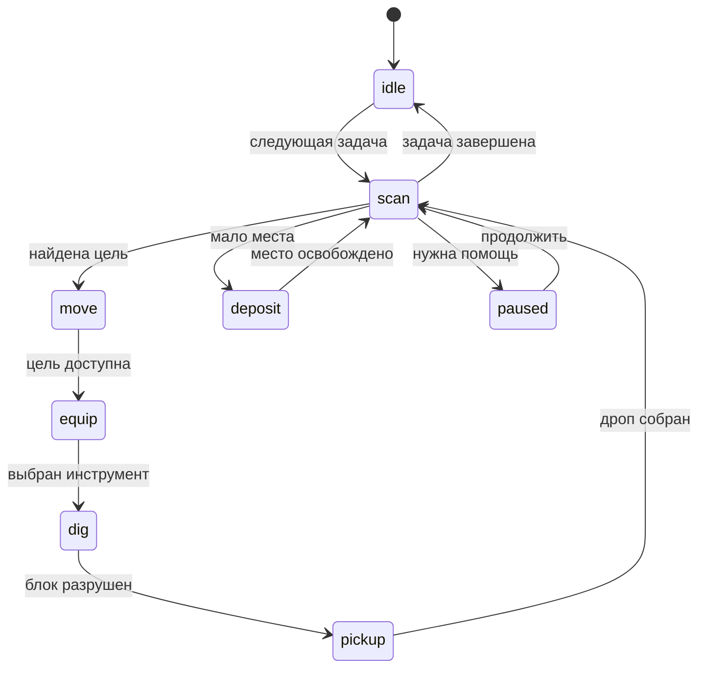

# Добыча и сбор — Mineflayer Bot 1.12.0

В лаунчере: **Расширения → Mineflayer Bot → Добыча**.
Выберите «Лес» и нажмите **Добавить и начать**: по умолчанию рубит доступные стволы в радиусе
16 блоков. Текущий этап, добытые блоки и причина паузы видны прямо в панели.
Добыча хранится в инвентаре бота; сундук не требуется.

В отдельной раскрывающейся группе **Тоннели и освещение** задаются размеры
проходов при добыче руды. По умолчанию тоннель — **2 × 2**, лестница — шириной
**2 блока**, с просветом **3 блока от пола**. Ширина настраивается от 1 до 3,
высота тоннеля — от 2 до 4, просвет лестницы — от 3 до 4 блоков. Ступень всегда
опускается или поднимается на один блок за один горизонтальный шаг. На переходе
между уровнями дополнительно открывается потолок над более высокой ступенью,
чтобы обратный подъём не требовал докапывания. Пол обеих полос сохраняется.
Нижний виток лестницы не может разобрать пол уже запланированной верхней
ступени; пол пройденных участков защищается и при следующем подходе к руде.

Размер и стоимость всей расчистки входят в поиск Pathfinder. Новая проходка
состоит из прямых участков и квадратных поворотов; поиск выбирает ответвления
к руде с учётом препятствий. Уже открытые пещеры и узкие проходы можно использовать
без обязательного расширения. Для доставки, выгрузки и возвращения сначала
ищется обычный путь по существующим проходам. Копание и строительство
используются только если обычный поиск не нашёл путь. Координаты пройденных
шагов не превращаются в обязательный обратный маршрут.

Переключатель **Ставить факелы в пещере** по умолчанию выключен. При включении
бот берёт обычные `torch` из инвентаря и ставит на доступные стены во время
проходки и добычи. Интервал по умолчанию — около **8 блоков**, настройка —
от 4 до 16. Существующие факелы учитываются; стены, которые ещё предстоит
убрать по текущему пути, не используются. Если факелов или подходящей стены
нет либо сервер отказал в установке, работа продолжается. После установки
бот возвращает инструмент в руку; факелы сохраняются при передаче добычи.

Настройки сохраняются в лаунчере и передаются при запуске бота и добавлении
задач добычи/тоннеля. **Применить к боту** обновляет подключённого бота:
новые размеры используются при следующем подходе, без отмены текущей работы.
Из чата доступна команда:

```text
!work tunnels 2 2 2 3 on 8
```

Аргументы: ширина и высота тоннеля, ширина и просвет лестницы, `on|off`
для факелов и интервал. Настройка из игрового чата действует до переподключения.

**Принести мне добычу** прерывает работу, ведёт бота к видимому владельцу,
выбрасывает добычу перед ним, возвращает к месту работы и
продолжает прерванную задачу. Инструменты, броня, еда и полезное снаряжение
сохраняются. Ручная пауза остаётся после передачи. При заполненном инвентаре
пауза снимается после передачи. Команды `deliver`, `bring`, `give` равнозначны.
При низком здоровье доставка ждёт лечения и продолжается автоматически.
Повторная команда возвращает номер той же доставки; после передачи бот
возобновляет возвращение к работе, даже если в дороге пришлось поесть или лечиться.
Доставка может расчищать безопасные препятствия, ставить опоры и строить столб
вверх из шахты. Для строительства используются земля, булыжник, колотый глубинный
сланец, незеррак и обычные каменные блоки. После передачи бот сохраняет до 64
таких блоков для пути. При возвращении в заполненную своим столбом шахту бот
подходит к его вершине и последовательно разбирает собственные опоры, проверяя
твёрдую опору под следующим шагом. Контейнеры, жидкости и опасные блоки сохраняются.
Быстрый маршрут добычи выполняет до 16 проверенных шагов подряд: разрушение
предусмотренного маршрутом блока само по себе не запускает новый поиск пути.
Обычные `come` и `follow` на суше используют полный маршрут в известной местности.
Для дальних целей или цели за границей загруженных чанков бот идёт длинными
проверенными участками до 48 шагов. Граница известной местности позволяет
начать движение без ожидания полного пути в ещё неизвестные чанки;
короткие участки по пять блоков для обычного подхода не используются.
Прокапывание ступеней вниз
включается только при подходе к руде; завершение или отмена добычи восстанавливает
обычные настройки движения и копания. При выходе из глубокой шахты поиск отдаёт
приоритет подъёму к цели, сохраняя проверки препятствий, опор и опасностей.
Загрузка соседнего чанка не прерывает готовый путь; обновление чанка самого
маршрута по-прежнему вызывает перепланирование. При прокладывании лестницы
сохраняется опора под точкой назначения. Если есть строительные блоки, бот
может выйти из узкой шахты столбом, предварительно расчищая потолок.

Пока выполняется начальный участок проходки, тот же поиск достраивает маршрут
вперёд. Проходка начинает с нескольких запланированных шагов. Совместимое
продолжение используется без повторного поиска от каждого сломанного блока;
даже при исчерпании бюджета поиска сохраняются уже проверенные следующие шаги.
Изменение местности или цели отменяет устаревшее продолжение.
Посторонние обновления блоков, которые поиск не использовал, не отменяют
продолжение. Если поиск выбрал другую ветку, следующий участок готовится
от конца уже принятого плана, пока бот копает. Копание начинается только
в пределах реальной досягаемости и по открытой грани; бот удерживает взгляд
до подтверждения разрушения. Обычная ходьба и остановка на цельном полу
не включают приседание. При прокапывании ступени вниз сохраняется ровная
защитная стойка, без повторного включения и выключения на каждом блоке.
Блоки ступени разбираются по доступности: сначала открывается стенка,
скрывающая нижний блок. Во время копания бот не шагает на эту будущую ступень.
В панели «Подходит к блоку» обозначает всё выполнение подхода, включая
расчистку прохода, а не непрерывный новый расчёт маршрута.
На суше поиск быстрее выбирает подходящий маршрут, а возле лестницы учитывает
стоимость обходов, чтобы не прыгать на соседние препятствия вместо подъёма.
При выходе из воды бот становится на выбранную опору и использует сохранённый
путь дальше. Сглаживание поворотов проверяет опору под ногами: срезать путь
через провал нельзя. Обычные прыжки не прокладываются над обнаруженной лавой.

Поиск руды хранит координаты в загруженных секциях. Разрушение или появление
блока обновляет одну позицию; повторная задача использует тот же индекс.
Загрузка или выгрузка чанка сбрасывает его запись. Неизвестные чанки по-прежнему
не считаются разведанными; безопасный путь зависит от загруженной местности,
инструментов и запаса строительных блоков.

**Инвентарь и состояние** открывает отдельную вкладку лаунчера: предметы,
экипировка, HP, сытость и броня обновляются автоматически. Нажатие на предмет
показывает прочность и зачарования. Команда `inventory` дополнительно сохраняет
локальный веб-просмотр через `mineflayer-web-inventory` 1.8.5. Сервер слушает
только 127.0.0.1; неизвестные текстуры показываются значком «?».

Панель добавляет задачи в очередь и даёт кнопки паузы, продолжения и отмены.
Команды добычи работают также без префикса: `forest`, `deliver`, `mine iron`.
Команды с префиксом в поле «Чат и команды
бота» выполняются локально от имени владельца. Обычный текст идёт в игровой чат.
В игре команды принимает только владелец и дополнительные владельцы из настроек,
в разрешённом канале (общий чат / личные сообщения).

## Примеры

Префикс по умолчанию `!`. Его можно изменить в настройках.

```text
!mine iron 64 32
!mine diamond,redstone 32 24
!mine stone,dirt 128 16
!ores 64 32
!forest 16 0 logs
!forest 20 0 leaves scaffold
!forest 12 64 logs plain
!area arena 1 100 64 100
!area arena 2 110 70 110
!quarry arena
!quarry 100 64 100 110 70 110
!quarry arena stone,dirt
!tunnel 16 2 3
!collect 16
!collect 16 raw_iron
!deliver
!inventory
!stash 100 64 98
!deposit
!work status
!work queue
!work pause
!work resume
!work remove 3
!work clear
!work stop
```

| Команда                                                         | Действие                                                                                                               |
| --------------------------------------------------------------- | ---------------------------------------------------------------------------------------------------------------------- |
| `mine блоки [количество] [радиус] [minY] [maxY]`                              | Добывает выбранные блоки. По умолчанию 64 целевых блока, радиус 32.                                                    |
| `ores [количество] [радиус] [minY] [maxY]`                                    | Все зарегистрированные руды и ancient_debris.                                                                          |
| `forest [радиус] [количество] [logs\|leaves] [scaffold\|plain]` | Стволы; при leaves также листва. По умолчанию радиус 16, все доступные стволы, подъём с опорами.                       |
| `wood …`                                                        | Синоним forest.                                                                                                        |
| `area имя 1\|2 [x y z]`                                         | Два угла именованной области; без координат используется позиция бота. `area list` перечисляет готовые области.        |
| `quarry имя [блоки]`                                            | Расчистка области сверху вниз, с включением обоих углов. Можно передать шесть координат вместо имени.                  |
| `digarea …`                                                     | Синоним quarry.                                                                                                        |
| `tunnel [длина] [ширина] [высота]`                              | Область впереди по направлению взгляда бота. Длина по умолчанию 16, размер сечения берётся из настроек (2 × 2). Нижний уровень на уровне ног; пол ниже остаётся. |
| `collect [радиус] [предмет]`                                    | Подбирает загруженный дроп, по умолчанию радиус 16.                                                                    |
| `stash x y z`                                                   | Сундук, бочка или шалкер для автоматической выгрузки. `stash clear` отключает.                                         |
| `deposit`                                                       | Добавляет отдельную задачу выгрузки.                                                                                   |
| `work status\|queue`                                            | Текущий этап, число разрушенных блоков, подобранных предметов, выгруженных предметов и очередь.                        |
| `work pause\|resume`                                            | Останавливает текущий этап / повторно проверяет цели и продолжает ту же задачу.                                        |
| `work remove номер`                                             | Удаляет ожидающую задачу.                                                                                              |
| `work move номер up\|down` | Переставляет ожидающую задачу вверх или вниз. |
| `work cancel номер` | Отменяет одну задачу, сохраняя остальные; для текущей ждёт остановки операций. |
| `work clear`                                                    | Очищает ожидающие задачи.                                                                                              |
| `work stop`                                                     | Отменяет текущую задачу и очередь.                                                                                     |

`количество` — число **разрушенных целевых блоков**, а не число единиц дропа.
Например, руда с Fortune может дать несколько предметов. `0` означает работать
до окончания доступных целей. Подобранный дроп учитывается отдельно по событию
`playerCollect` именно этого бота; исчезновение предмета само по себе не считается
успешным подбором.

Группы: `iron`, `diamond`, `coal`, `copper`, `gold`, `redstone`, `lapis`,
`emerald`, `quartz`, `ores`, `wood`/`logs`, `leaves`. Группы руд включают обычные
и глубинные варианты. Работают точные названия блоков, `minecraft:` и шаблоны
с `*` в конце, например `deepslate_*_ore` **не поддерживается**, а
`deepslate_diamond*` поддерживается. Несколько названий разделяются запятыми.

## Работа и восстановление

Радиус фиксируется относительно позиции **в момент добавления задачи**, включая
ожидающие задачи. Бот не переносит область поиска за собой. Максимальный радиус
64, объём прямоугольной области 32 768 блоков, очередь до 32 ожидающих задач.
Для `mine` радиус ограничивает расстояние по горизонтали, а диапазон Y задаётся независимо. По умолчанию поиск идёт от нижней границы измерения до высоты начала плюс радиус; доступны отдельные minY/maxY. Сканирование секций пропускает палитры без нужных блоков и уступает время физике. Поиск использует загруженные сервером чанки. Задача не обещает найти ресурсы в
незагруженном мире. Добыча руды может прорубать подход через безопасные блоки
внутри радиуса; маршрутные блоки не увеличивают счётчик выбранной руды.

Перед каждым этапом проверяются актуальные блоки и состояние бота. Инструмент
выбирается по скорости, пригодности для получения дропа и оставшейся прочности.
Инструменты с остатком 5 единиц или меньше исключаются. Если нужного инструмента
нет, задача ждёт на паузе: передайте инструмент боту и выполните `work resume`.
После двух неудач недоступная цель исключается до ручного продолжения. Ограниченный
поиск заканчивается с результатом «частично», если количество не достигнуто или
остались недоступные цели. Расчистка области остаётся на паузе с числом оставшихся
и незагруженных блоков, чтобы её можно было закончить после устранения препятствий.

Доступные грани ствола проверяются с текущего места: закрытый центр блока
не мешает рубить его видимую боковую грань. Ближайшие доступные брёвна и руды
добываются подряд, затем бот собирает дроп. Инструмент, уже находящийся в руке,
повторно не экипируется. Найденные цели переиспользуются с проверкой актуального
мира; полный поиск повторяется раз в 3 секунды или после исчерпания списка.
Недоступный подход ограничен 10 секундами и после двух попыток пропускается.
Задержавшийся дроп учитывается возле всех недавно разрушенных блоков.

При двух свободных слотах или меньше бот переходит к выгрузке. Сохраняются
инструменты, оружие, броня, еда, щиты, вёдра, тотемы, жемчуг и факелы. При рубке
с опорами сохраняется до 64 блоков dirt/cobblestone/cobbled_deepslate/netherrack.
Сундук необязателен и скрыт в дополнительных настройках панели. Без него бот
хранит добычу у себя. Когда место заканчивается, нажмите **Принести мне добычу**
или освободите инвентарь через игровой мир и продолжите. Если заданный сундук
не загружен, заполнен или выгрузка не освободила место, задача ждёт на паузе.

Порог остановки по здоровью — 6 из 20. После восстановления выше порога бот
автоматически продолжает добычу или доставку. Автоеда, защита от стрел и аварийный MLG приостанавливают
добычу и возвращают ей управление после завершения. Ручная пауза не снимается
автоматически. Команды `come`, `follow`, `goto`, `attack`, `bow`, `pvp` и общий
`stop` отменяют добычу перед передачей управления другому контроллеру. Ошибка
в параметрах новой задачи не отменяет уже работающую задачу.

Жидкости, блоки с водой внутри, контейнеры, порталы, спавнеры и неразрушаемые
блоки не добываются. Проверяются соседние жидкости и падающие блоки сверху.
Перед разрушением опоры под ногами бот ищет соседнее безопасное место.
Для высоких деревьев навигатор может ставить опоры из инвентаря внутри радиуса;
при спуске бот разбирает собственную опору под ногами, только если сразу под
ней есть твёрдая площадка для приземления. Остальные опоры остаются на месте.
Рубка выбирает все неотёсанные стволы в радиусе, включая
стволы в постройках; задавайте радиус относительно выбранного леса.
Рубка начинает с доступной нижней части ствола; для начала работы опоры не нужны.
При подходе разрешается убирать только стволы и листву, без прокладки пути
через каменные и земляные постройки. Для верхушек высоких деревьев нужны
строительные блоки из инвентаря.

Очередь, углы областей и сундук хранятся на время текущего подключения.
После отключения/переподключения или перезапуска их нужно задать заново.
Смерть и остановка бота отменяют работу. Это не фоновая бесконечная добыча
с автосозданием инструментов и поиском новых чанков.

## Устройство



- `gathering-plan.cjs`: проверка задачи, области, группы блоков, границы,
  безопасность, сохранение инструментов и еды.
- `gathering-defaults.json`: общие настройки проходов и освещения для worker-а и панели.
- `gathering.cjs`: очередь, реальные `NestedStateMachine` и `StateTransition`,
  отдельные асинхронные этапы, отмена, повторный поиск, дроп, выгрузка.
- `gathering-commands.cjs`: один обработчик для игровых и локальных команд.
- `MineflayerGatheringControls.tsx`: панель управления лаунчера.
- `web-inventory.cjs`: настоящий сервер mineflayer-web-inventory и встроенный
  браузерный клиент для установки без npm install-скриптов.

`mineflayer-statemachine` 1.7.0 используется для переходов. Его `BotStateMachine`
подписывается на старое событие `physicTick`; здесь `NestedStateMachine.update()`
вызывается через актуальное `physicsTick` и по завершении операций. Listener-ы
снимаются при закрытии контроллера. `mineflayer-tool` 1.2.0 используется через
`Tool.getDigTime`; расчёт учитывает современные зачарования и эффекты.
Существующий `minecraft-pathfinding-2026` сохраняется, настройки движения
восстанавливаются после задачи или паузы. Поздний результат операции экипировки
дожидается завершения перед следующей задачей; поздно открытый контейнер закрывается.

## Изученные реализации

Из предоставленного Baritone 26.1 изучены `MineProcess.java` и
`BuilderProcess.java`: повторные сканирования, исключение недоступных целей,
учёт дропа и расчистка кубоида слоями. Код задач написан для Mineflayer; Java-классы
не переносятся и не запускаются.

Из предоставленного Mineflayer-Templates изучены `MiningBehavior.js`,
`WoodCuttingBehavior.js`, `OreScanner.js`, `ToolHandler.js`, `TaskQueue.js`,
`AreaRegistry.js` и `DepositBehavior.js`: отдельные поведения, очередь,
именованные области, управление инвентарём и инструментами. Использованы идеи
организации; исходники шаблонов не копировались в расширение.

Официальные источники:

- [mineflayer-statemachine](https://github.com/PrismarineJS/mineflayer-statemachine)
  и [API](https://github.com/PrismarineJS/mineflayer-statemachine/blob/master/docs/api.md).
- [mineflayer-tool](https://github.com/PrismarineJS/mineflayer-tool)
  и [Tool.ts](https://github.com/PrismarineJS/mineflayer-tool/blob/master/src/Tool.ts).
- [mineflayer-collectblock](https://github.com/PrismarineJS/mineflayer-collectblock)
  и [CollectBlock.ts](https://github.com/PrismarineJS/mineflayer-collectblock/blob/master/src/CollectBlock.ts).

`collectblock` изучен как эталон цепочки подход → инструмент → копание → дроп
и проверки места перед работой. Его готовый плагин связан с классическим
`mineflayer-pathfinder`: `setMovements`, `movements.safeToBreak`, классические
`GoalLookAtBlock`/`GoalFollow`. Здесь реализован собственный сбор, совместимый
с существующим навигатором и контроллерами выживания и боя.

## Проверка и сборка

```powershell
pnpm test:worker
pnpm typecheck
cargo check --manifest-path src-tauri/Cargo.toml
pnpm package:extensions
```

`gathering.test.mjs` проверяет добычу и дроп на данных Minecraft 1.20.4 и 26.1.2,
выбор инструмента, прочность, паузу/продолжение, выгрузку, отмену с задержанной
экипировкой, безопасность, неполную расчистку и локальные команды. Проверки
используют симуляцию мира. `gathering-navigation.test.mjs` также проверяет
настоящий навигатор и физику: расчистку с подходом, добычу руды за каменной стеной
и рубку высокого дерева с установкой опор и спуском.
Добавлена отдельная проверка елового ствола без строительных блоков. Передача
проверяется с сохранением инструмента и еды, возвратом, возобновлением задачи и
ручной паузой.
Проверка соседнего елового ствола использует настоящий плагин копания Mineflayer
и проверяет пакеты начала и завершения копания видимой боковой грани без обхода.
Также проверяются добыча соседних брёвен подряд, задержанный дроп, заполнение
инвентаря в процессе рубки, пропуск зависшего подхода и доставка после лечения.
Проверки физики включают длинный тоннель без пересчёта после каждого блока,
выход из шестиметровой шахты с установкой столба из глубинного сланца, расчистку
потолка, передачу добычи и обратный спуск по собственным опорам.
`web-inventory.test.mjs` проверяет HTTP, Socket.IO, данные предметов
1.20.4/26.1.2, обновления слотов и очистку слушателей после переподключения.
Поведение конкретного игрового сервера
потребует проверки на нём. Пакет включает модули добычи, зависимости, инструкцию
и архив редактируемых исходников. При обновлении старой установки лаунчер
добавляет недостающие зависимости до запуска worker-а.


## Панели лаунчера

Во вкладке **Добыча** отображаются текущая задача, очередь и история. Можно добавлять задачи, поднимать/опускать ожидающие, удалять одну, отменять текущую или очищать очередь. Доставка временно сохраняет текущую работу и показывает её отдельно.

Во вкладке **Инвентарь** внутри лаунчера доступны 36 слотов, быстрый доступ, броня и вторая рука, здоровье/max HP, сытость, насыщение и очки защиты. Выбор предмета показывает количество, прочность и зачарования. Показатели поступают из Mineflayer и сбрасываются при отключении. Веб-инвентарь остаётся совместимым с командой inventory.

Навигация во время добычи контролирует отсутствие прогресса, включая зависшие асинхронные шаги. Отмена привязана к номеру запуска маршрута, поэтому поздний поиск восстановления не может оживить отменённый путь. Таймаут подхода продлевается при движении и настоящем разрушении блока; длительная полезная работа не считается зависанием. Подземный подход разрешает короткие проверенные участки с разрушением и вырезает соседние ступени с твёрдой опорой; блок под самим ботом, жидкость и защищённые блоки не используются для спуска.
